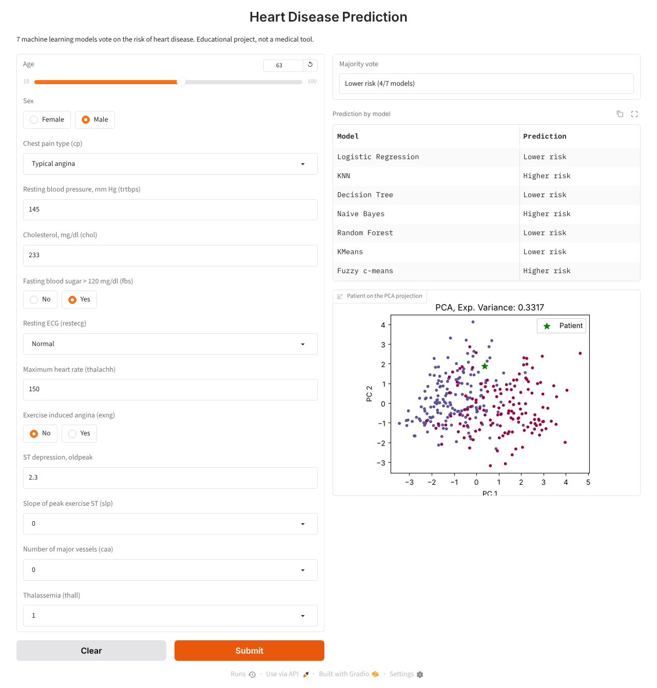

# Heart Disease Prediction – ML App with Gradio

Comparison of 7 machine learning models to predict the risk of heart disease, plus an interactive [Gradio](https://www.gradio.app/) app where the models vote on a new patient.



## Dataset

[Heart Disease dataset](https://archive.ics.uci.edu/dataset/45/heart+disease) (UCI, Cleveland subset, Kaggle version): 303 patients, 13 clinical features (age, sex, chest pain type, blood pressure, cholesterol, max heart rate, etc.). One duplicated row is removed, leaving 302.

**Encoding note:** the Kaggle version re-encodes several columns relative to the original UCI data. Comparing with UCI (same patients, category counts and class averages), `output = 1` corresponds to **no disease** (UCI `num = 0`) and `output = 0` to **disease**, even though the Kaggle data card says the opposite. The app uses the UCI meaning for `output`, `cp` (0 = asymptomatic … 3 = typical angina) and `restecg` (0 = LV hypertrophy, 1 = normal, 2 = ST-T abnormality). Precision, recall and F1 below are computed for class 1.

## Models

| Model | Accuracy | Precision | Recall | F1 |
|---|---|---|---|---|
| Logistic Regression | 0.787 | 0.763 | 0.879 | 0.817 |
| Fuzzy c-means | 0.721 | 0.735 | 0.758 | 0.746 |
| KMeans | 0.770 | 0.721 | 0.939 | 0.816 |
| KNN (k=2) | 0.738 | 0.815 | 0.667 | 0.733 |
| Decision Tree | **0.836** | 0.780 | **0.970** | **0.865** |
| Naive Bayes | 0.820 | 0.789 | 0.909 | 0.845 |
| Random Forest | 0.803 | 0.769 | 0.909 | 0.833 |
| **Majority vote (7 models)** | 0.787 | 0.750 | 0.909 | 0.822 |

Stratified 80/20 split (`random_state=42`, 61 test patients). The scaler is fitted only on the training set. For the clustering models (KMeans and Fuzzy c-means), each cluster is mapped to the majority class of its training points.

The app trains the same models on all 302 patients when it starts.

The notebook also compares 2D projections of the data with PCA, t-SNE and UMAP.

## Project structure

```
├── app.py                        # Gradio app
├── images/app.png
├── heart_disease_models.ipynb    # Training, evaluation and projections
├── heart.csv                     # Dataset
├── requirements.txt
└── LICENSE
```

## How to run

```bash
pip install -r requirements.txt
python app.py
```

Then open http://127.0.0.1:7860.

To run the analysis, open `heart_disease_models.ipynb` in Jupyter.

## Notes

This is an educational project, not a medical tool. With only 61 test patients, differences of a few points between models are not significant.

## Author

José Adrián Ochoa Sánchez – [GitHub](https://github.com/Adrian-8a) · [LinkedIn](https://www.linkedin.com/in/adrian-ochoa-ai)
